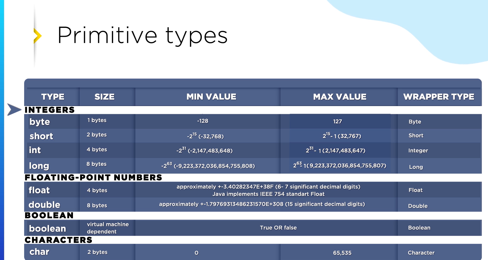

# Datatypes(Primitive DataTypes)
These are snapshots of different data types in java.

###  Primitive types.
1. Java is a strong-typed language.
2. Java compiler checks for type compatibility in code.
3. If compatibility is not matched,compiler throws error.
4. Normal decimal literal like(1.2,3.24 etc.) are considered as double.
5. Similarly, 2_000_00_000 literals are considered as integer.
6. To specify the compiler f,l,d etc. are mentioned after literal.
7. for datatype conversion, a bigger size datatype can hold smaller size datatype.
8. if we need to convert from smaller size data to bigger size data, we need to typecast.
9. In the above case,there is a chance of overflow.
10. Assigning integer literals to its wrapper class is autoboxing and vice-verse is unboxing.

###  Number System.
1. There are decimal, binary,octal and hexadecimal number system.
2. in Java numbers are by default decimal.Binary,octal and hexadecimal numbers need to be represented differently.

### Arrays
1. Arrays are collections of elements of primitive data types.
2. In java,arrays are of fixed length.
3. Each element of array is initialized by default value of the primitive data type.
4. Arrays class is used to do operations on array like print and sort.
5. 2D arrays are not defined in java explicitly. It is defined as arrays of arrays.

### Operators and Operations.
1. Unary operators like ++, -- are used in prefix and suffix.
2. Prefix is one in which the operations are performed and result is assigned.
3. Suffix is one in which the operations are performed after the result is assigned.
4. logical operation have two types of operations.
   1. Short circuit logical operation.
   2. Non-short circuit logical operation.
5. Short circuit logical operation is one in which the second operand is not evaluated if the first operand is sufficient to determine the result of the expression.
6. Non-short circuit logical operation is one in which the second operand is evaluated even if the first operand is sufficient to determine the result of the expression.
7. Bitwise operators are used to perform operations on bits and binary numbers.
8. Ternary operator is used to evaluate a boolean expression and return one of the two values based on the result of the expression.
9. Assignment operators are used to assign values to variables. They include simple assignment operator(=) and compound assignment operators(+=, -=, *=, /=, %=, &=, |=, ^=, <<=, >>=, >>>=).
10. Operator precedence is the order in which operators are evaluated in an expression. 
11. It is determined by the rules of operator precedence and associativity. 
11. Operators with higher precedence are evaluated before operators with lower precedence. 
12. If two operators have the same precedence, their associativity determines the order of evaluation. 
13. Left-associative operators are evaluated from left to right, while right-associative operators are evaluated from right to left.

### BigDecimal and BigInteger.
1. BigDecimal and BigInteger are classes in java that are used to represent and perform operations on large numbers with high precision.
2. BigDecimal is used for representing decimal numbers with arbitrary precision, while BigInteger is used for representing integers with arbitrary precision.
3. Both classes provide methods for performing arithmetic operations, such as addition, subtraction, multiplication, and division, as well as methods for comparing and manipulating the values.
4. BigDecimal is used when we need to perform operations on currency values like calculating credit card payment etc.

### Maths class.
1. The Math class in Java provides a collection of static methods for performing mathematical operations such as basic arithmetic, trigonometric functions, logarithmic functions, and more.
2. Some commonly used methods in the Math class include:
   i`Math.abs()`: Returns the absolute value of a number.
   ii`Math.sqrt()`: Returns the square root of a number.
   iii.`Math.pow()`: Returns the value of the first argument raised to the power of the second argument.
   iv.`Math.max()`: Returns the maximum of two values.
   v.`Math.min()`: Returns the minimum of two values.
3. The Math class also provides constants such as `Math.PI` and `Math.E` for representing the mathematical constants pi and e, respectively.
4. The Math class is part of the `java.lang` package, which is automatically imported in every Java program, so you can use its methods without needing to import it explicitly. 

### Type of Expression in Java.
1. Expression is a combination of variables, operators, and method invocations that are constructed according to the syntax of the language, that evaluates to a single value.
2. The difference between expression and statement is that expression evaluates to a single value, while statement performs an action.
3. In Java type of Expression is determined by the type of the operands and the operators used in the expression.
4. If the operands are of different types, Java will perform type promotion to convert them to a common type before evaluating the expression.
5. if operands are byte, short, or char, they are promoted to int before the operation is performed.
6. If the operands are byte and int, the byte operand is promoted to int before the operation is performed.
7. if the operands are int and long, the int operand is promoted to long before the operation is performed.
8. If the operands are long and float, the long operand is promoted to float before the operation is performed.
9. If the operands are float and double, the float operand is promoted to double before the operation is performed.
10. If the operands are of string type, the result of the expression is also of string type.
11. if the operands are of boolean type, the result of the expression is also of boolean type.
12. if the operands are string and int, the result of the expression is of string type.
13. if the operands are string and null, the result of the expression is of string type.

### Primitive and reference type comparison in Java
1. if (==) is used to compare primitive types, the result will be true if the values are equal, and false otherwise.
2. if (==) is used to compare reference types, the result will be true if both references point to the same object, and false otherwise.
3. In case of Integer wrapper class, if the value is between -128 and 127, the result will be true if the values are equal, and false otherwise. This is because Java caches Integer objects for values in this range to improve performance.
4. In case of double wrapper class, if the value is NaN (Not a Number), the result will be false if the values are equal, and true otherwise. This is because NaN is not considered equal to any value, including itself.
5. In case of byte wrapper class, if the value is between -128 and 127, the result will be true if the values are equal, and false otherwise. This is because Java caches Byte objects for values in this range to improve performance.
6. In case of char wrapper class, if the value is between '\u0000' and '\u007F', the result will be true if the values are equal, and false otherwise. This is because Java caches Character objects for values in this range to improve performance.
7. In case of boolean wrapper class, if the value is true or false, the result will be true if the values are equal, and false otherwise. This is because Java caches Boolean objects for values in this range to improve performance.
8. In case of short wrapper class, if the value is between -128 and 127, the result will be true if the values are equal, and false otherwise. This is because Java caches Short objects for values in this range to improve performance.
9. In case of long wrapper class, if the value is between -128 and 127, the result will be true if the values are equal, and false otherwise. This is because Java caches Long objects for values in this range to improve performance.
10. In case of float wrapper class, if the value is NaN (Not a Number), the result will be false if the values are equal, and true otherwise. This is because NaN is not considered equal to any value, including itself.
11. In case of String wrapper class, if the value is null, the result will be false if the values are equal, and true otherwise. This is because null is not considered equal to any value, including itself.
